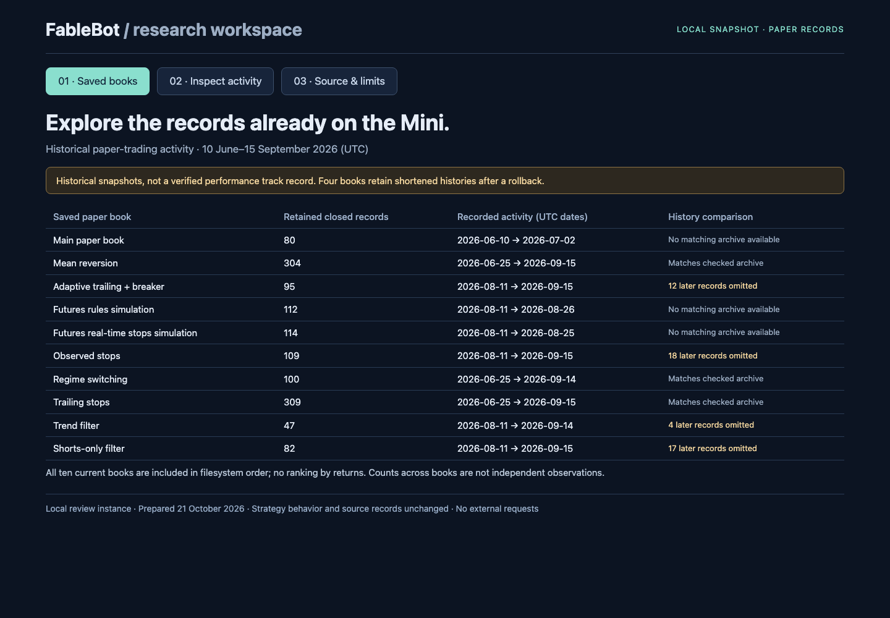

# FableBot

A Python **paper-trading and strategy-research project**. FableBot separates
strategy signals, position sizing, simulated execution, and research validation.
It includes a composable strategy DSL, evolutionary and TPE search, NumPy
gradient-boosted trees, tabular Q-learning, and a decision journal.

The project demonstrates software design and experimentation. It does not
establish profitable trading performance, and it has no real-money broker adapter.

## Explore the showcase

[**Interactive preview**](https://ariankhademi.github.io/FableBot/) ·
[**39-second recording**](https://ariankhademi.github.io/FableBot/media/fablebot-showcase.mp4)

[](https://ariankhademi.github.io/FableBot/)

The preview uses aggregate counts from ten saved paper-trading books covering
**June 10–September 15, 2026 UTC**. Inspect recorded activity by book, instrument,
and strategy. Four saved histories omit later records found in their pre-rollback
archives; the preview identifies these gaps. It is a software showcase, not a
verified performance track record or a live account view.

Only aggregate counts, dates, and labels are included. Raw trade records, market
prices, account balances, and vendor datasets remain private. See
[showcase provenance and limitations](docs/showcase.md).

For an offline copy, open [`docs/index.html`](docs/index.html) from a local clone;
the recording is [`docs/media/fablebot-showcase.mp4`](docs/media/fablebot-showcase.mp4).
No setup, login, or external assets are needed. `index.html` is the complete
preview, not an unfilled template.

## Run the reproducible synthetic demo and tests

The reference environment is **Python 3.12**. From the repository root:

```sh
python3.12 -m venv .venv
.venv/bin/python -m pip install --require-hashes -r requirements.txt
.venv/bin/python -m pip check
.venv/bin/python -m pytest -q
.venv/bin/python scripts/demo.py --seed 7 --output demo-output
```

On Windows, use `.venv\Scripts\python.exe` in place of `.venv/bin/python`.
Dependency installation needs internet access; tests and the demo use synthetic
inputs and mocked services. No API keys or market-data accounts are needed.

Open `demo-output/dashboard.html` in a browser. It contains embedded SVG charts
and works offline. The same directory holds `summary.json` and `synthetic.csv`.
The default seed generates 500 invented daily bars and four independent runs:
three named strategies and a DSL equivalent of mean reversion. The summary
includes the input checksum, trade counts, return, drawdown, and equity curves.
Repeating the same seed in the pinned environment produces identical files.
Use a new output directory each time; the demo refuses to overwrite an existing
path and never reads your configuration, credentials, or account state.

## What is implemented

| Area | Implementation |
| --- | --- |
| Signals | Mean reversion, momentum breakout, EMA trend following, ADX regime switching |
| Strategy DSL | Indicator features and composable entry/exit conditions; mutation and crossover |
| Search | Numeric TPE suggestions and evolutionary genome search with persisted populations |
| Learned signals | Small NumPy gradient-boosted regression trees and tabular Q-learning |
| Simulation | ATR sizing, one position per instrument, stops, optional trailing, gap fills |
| Research | Train/evaluation splits, time-block validation, perturbation and optional held-out/DSR checks |
| Observability | Decision journals, shadow positions, reports, paper-account dashboards |

These are distinct capabilities: the synthetic demo exercises named/DSL
strategies and backtesting, while the showcase inspects saved activity counts.
Neither exercises the optimizer or learned models. Tests cover all
of those components. See the [architecture](docs/PROJECT_OVERVIEW.md).

## Risk and research limitations

- The default **1% is a position-sizing budget**, not a guaranteed maximum loss.
  Gaps, slippage, and polling delays can produce larger losses. Validated account
  configurations and sizing calls require a positive budget no greater than 1%.
- The backtester uses signal-bar closing fills and a simple basis-point friction
  model. It simulates one instrument at a time, not a portfolio with realistic
  liquidity, margin, financing, or contract-roll behavior.
- Validation is experimental. Effective trial counts use a capped heuristic;
  short datasets may omit the holdout; repeated selection can reuse the same
  data; annualization is keyed to timeframe rather than each asset's calendar.
- The ML/RL training commands sample six seeds, below the ten-trial threshold for
  the DSR check. Results explicitly flag skipped checks. Qualification is a
  workflow label, not proof of a statistically reliable or profitable strategy.

Read [validation details](docs/validation.md) and [risk rules](RISK_RULES.md)
before interpreting any result. Historical files under `analysis/` are dated
paper-experiment records, not current performance evidence.

## Optional market-data workflows

The existing scripts can fetch Yahoo Finance, Stooq, or Binance data, maintain
paper accounts, and run searches. They are **not offline demo commands**.
The legacy account dashboards also load Chart.js from a CDN.
[Operations](docs/operations.md) documents the commands, separate state
directories, and the optional Claude/GitHub reviewer. The reviewer can edit code
and create draft PRs; installing dependencies or running the demo never starts it.

Configuration remains in `config*.yaml`. Existing strategy parameters, source
routing, account state formats, and scheduler defaults are preserved. No process
is automatically installed or started.

## Development

`requirements.in` records direct dependencies; `requirements.txt` pins the full
resolved set with distribution hashes. The preparation lock preserves the
installed baseline versions where available. Python 3.12 is the supported
reference setup; the older Python 3.9 application baseline was also regression
tested, but this lock is generated for 3.12.

To intentionally refresh the lock with uv, review the resulting dependency diff:

```sh
uv pip compile requirements.in --python-version 3.12 --universal --generate-hashes --no-annotate --output-file requirements.txt
```

The GitHub Actions workflow installs the lock, checks dependencies, and runs
pytest and the demo in a Linux network namespace without network access. Local
tests also fail unexpected Python socket connections. Adding a workflow file does
not mean a hosted run has passed; check the [latest runs](https://github.com/ArianKhademi/FableBot/actions/workflows/offline.yml).

## Code and data rights

FableBot is **source-available under [PolyForm Noncommercial 1.0.0](LICENSE)**.
The license permits noncommercial use and includes specific permitted purposes;
see its complete terms. Distributing copies requires preserving the license
terms and the attribution in [NOTICE](NOTICE). It is not an unrestricted
open-source license. Dependencies retain their own licenses.

Market data has separate provider terms; this license does not grant rights to
redistribute it. [Data guidance](docs/wrds-data.md) covers the local CSV interface.
No WRDS/CRSP export, cache, account state, raw trade record, or vendor price chart
is included in the showcase. Keyless access does not imply
redistribution permission; see [yfinance's notice](https://ranaroussi.github.io/yfinance/).

This is an educational simulation project, not financial advice. Simulated or
historical results do not predict future performance.
